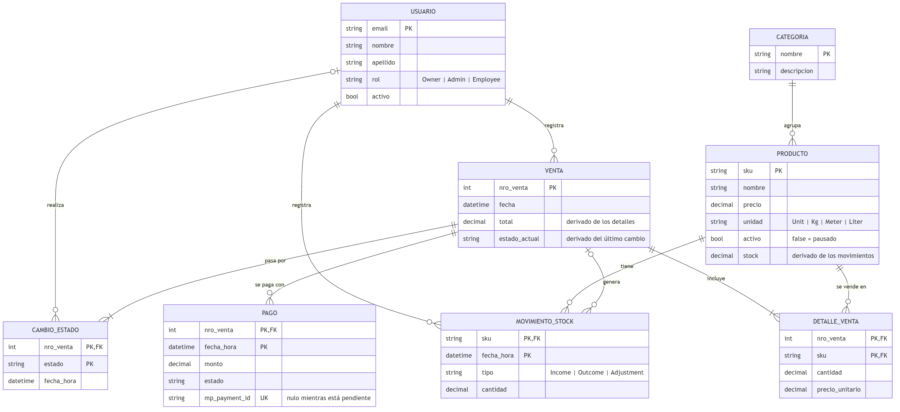
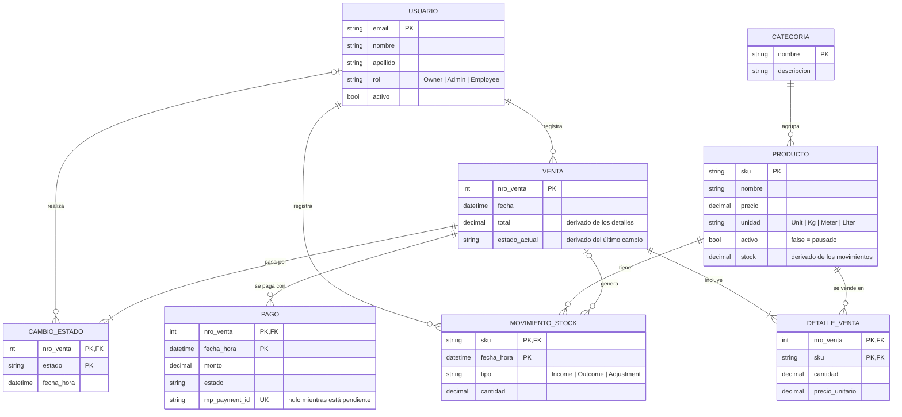
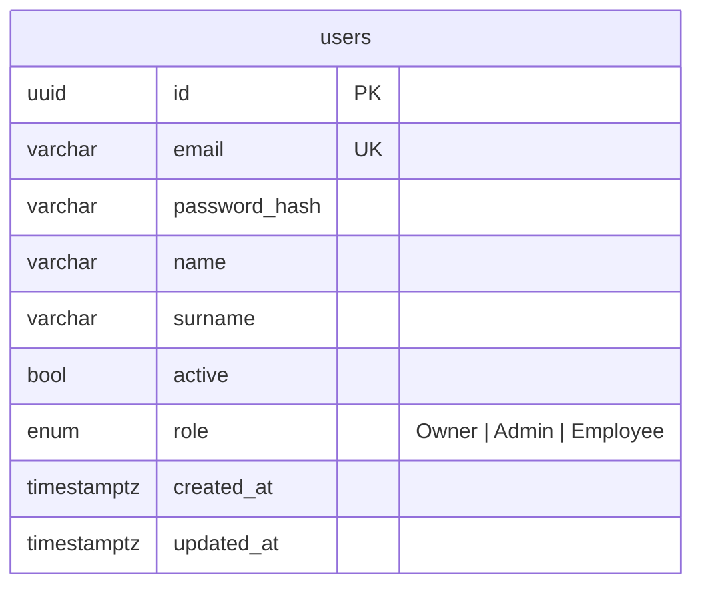
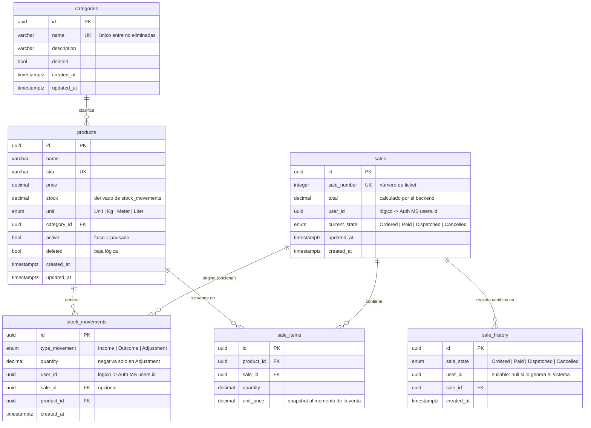
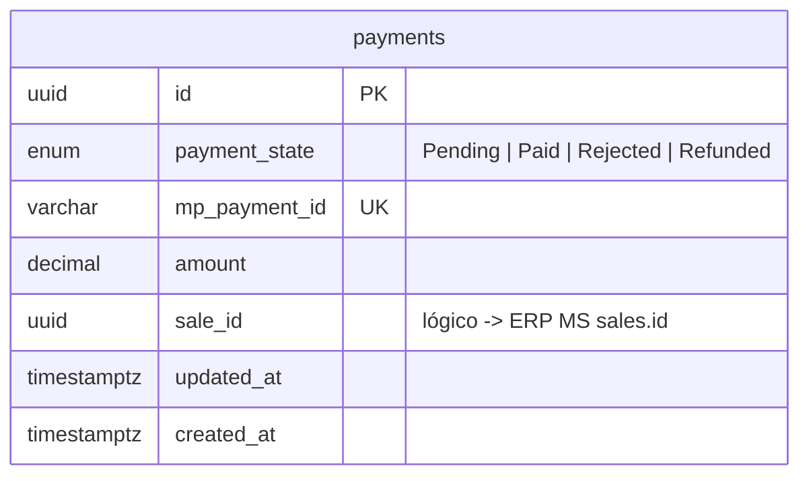

# Modelo Relacional — ERP para PyMEs

> Motor: PostgreSQL. ORM: Prisma `7.10.0`. Una base de datos por microservicio (Auth, ERP, Payments) — **sin claves foráneas entre servicios**, por diseño (ver [reglas de negocio, RN-18](./reglas-de-negocio.md#5-integridad-entre-microservicios)).
>
> Diagrama interactivo: [Tesis en dbdiagram.io](https://dbdiagram.io/d/Tesis-6ab14a9c9ba2420e18d18221)

El modelo de datos se documenta en dos niveles:

1. **Modelo conceptual (DER):** el dominio del negocio. Cada entidad se identifica por su clave natural, es decir, por atributos propios del negocio. No incluye identificadores artificiales, microservicios, índices ni campos de auditoría.
2. **Modelo físico:** las tablas que se implementan en PostgreSQL, con una base por microservicio (secciones 1 a 5).

## Diagrama entidad-relación (modelo conceptual)

Notación pata de gallo. Las entidades débiles y la relación M:N con atributos se detallan en las tablas siguientes. El mismo modelo está en [`der-conceptual.dbml`](./der-conceptual.dbml), para visualizarlo en dbdiagram.io.



<details>
<summary>Fuente del diagrama (Mermaid)</summary>



</details>

### Entidades

| Entidad | Clave natural | Tipo | Justificación |
|---|---|---|---|
| Usuario | `email` | Fuerte | Es el identificador con el que el usuario inicia sesión y es único en el sistema |
| Categoría | `nombre` | Fuerte | Es como el negocio identifica una categoría (RN-19) |
| Producto | `sku` | Fuerte | Código del producto; no se reutiliza nunca, ni siquiera si el producto se da de baja (RN-20) |
| Venta | `nro_venta` | Fuerte | Número impreso en el ticket, con el que el empleado y el cliente identifican la venta (RN-21) |
| Cambio de estado | `nro_venta` + `estado` | Débil de Venta | Los estados solo avanzan: una venta pasa una única vez por cada estado (RN-09) |
| Pago | `nro_venta` + `fecha_hora` | Débil de Venta | Una venta puede tener más de un intento de pago (por ejemplo, uno rechazado y otro aprobado) |
| Movimiento de stock | `sku` + `fecha_hora` | Débil de Producto | Es un evento del producto; no tiene identidad propia en el negocio |

### Relaciones

| Relación | Entidades | Cardinalidad | Atributos |
|---|---|---|---|
| registra | Usuario — Venta | 1 : N | — |
| registra | Usuario — Movimiento de stock | 1 : N | — |
| realiza | Usuario — Cambio de estado | 0..1 : N (sin usuario si lo genera el sistema, RN-10) | — |
| agrupa | Categoría — Producto | 1 : N | — |
| **incluye** | Venta — Producto | **M : N** (toda venta incluye al menos un producto) | `cantidad`, `precio_unitario` |
| pasa por | Venta — Cambio de estado | 1 : N (identificadora) | — |
| se paga con | Venta — Pago | 1 : N (identificadora) | — |
| tiene | Producto — Movimiento de stock | 1 : N (identificadora) | — |
| genera | Venta — Movimiento de stock | 0..1 : N (solo los movimientos originados por una venta) | — |

`DETALLE_VENTA` representa la relación M:N **incluye** con sus atributos, no una entidad independiente: la notación pata de gallo no permite atributos en una relación.

## Del modelo conceptual al modelo físico

Cada entidad se implementa como una tabla con un `uuid` como clave primaria, y su clave natural se conserva como restricción `UNIQUE`. De esta forma la regla de negocio sigue garantizada por la base de datos.

| Entidad / relación | Tabla | Clave natural en la base de datos |
|---|---|---|
| Usuario | `users` | `uq_users_email` |
| Categoría | `categories` | `uq_categories_name_active`: índice único parcial, solo entre categorías no eliminadas |
| Producto | `products` | `uq_products_sku`: global, también entre productos eliminados |
| Venta | `sales` | `uq_sales_sale_number` |
| incluye | `sale_items` | `uq_sale_items_sale_id_product_id` |
| Cambio de estado | `sale_history` | `uq_sale_history_sale_id_sale_state` |
| Pago | `payments` | `uq_payments_sale_id_created_at` |
| Movimiento de stock | `stock_movements` | No se impone en la base de datos (ver decisiones de diseño) |

**Por qué la clave primaria física es un `uuid` y no la clave natural:**

- **Referencias entre microservicios.** `sales.user_id` apunta a Auth MS y `payments.sale_id` a ERP MS, en bases distintas y sin FK (RN-18). Si la referencia fuera el `email`, un cambio de correo dejaría referencias inválidas en otra base, sin un `ON UPDATE CASCADE` que las corrija. El `uuid` no cambia nunca.
- **Claves naturales modificables.** El `email` de un usuario y el nombre de una categoría se pueden editar. El `uuid` absorbe ese cambio sin afectar a las tablas que lo referencian.
- **Claves compuestas.** Evita que las entidades débiles propaguen claves de dos o tres columnas en cada FK.

## Diagrama físico

Las tablas de cada microservicio se detallan en las secciones 1 a 3, y el [esquema DBML](#5-esquema-completo-dbml) completo puede visualizarse en [dbdiagram.io](https://dbdiagram.io/d/Tesis-6ab14a9c9ba2420e18d18221). `users` y `payments` no muestran relaciones porque están en otras bases de datos; en el dominio sí están relacionadas, como muestra el modelo conceptual.

## 1. Auth MS



## 2. ERP MS



## 3. Payments MS



## 4. Decisiones de diseño

- **Referencias cruzadas entre servicios sin FK.** `user_id` (en `sales`, `stock_movements`, `sale_history`) apunta lógicamente a `users.id` de Auth MS, y `payments.sale_id` a `sales.id` de ERP MS. Una FK entre bases distintas no puede existir en PostgreSQL; la integridad se valida en el servicio (ver RN-18).
- **Desnormalización intencional** (debe actualizarse siempre dentro de la misma transacción que la origina):
  - `products.stock` deriva de `stock_movements` (RN-01).
  - `sales.current_state` duplica el último registro de `sale_history`.
  - `sales.total` es un snapshot calculado por el backend, nunca aceptado del cliente (RN-06).
- **Snapshot de precio:** `sale_items.unit_price` congela el precio al momento de la venta (RN-07).
- **Cantidades decimales:** `quantity`/`stock` son `decimal(12,3)`; `products.unit` indica si el producto es fraccionable. El backend valida que solo `Kg`/`Meter`/`Liter` acepten decimales (RN-05). Soportar productos por peso/longitud es una decisión de diseño del equipo, no un requerimiento documentado originalmente en el alcance académico.
- **`products.active` vs. `deleted`:** ver RN-04.
- **`sale_history.user_id` nullable:** ver RN-10.
- **Sin entidad cliente:** ver RN-12.
- **`stock_movements.sale_id` nullable:** permite rastrear qué venta generó cada `Outcome` y revertirlo si se cancela (RN-11). Relación opcional (`ref: >?` en DBML).
- **Convención de signo en `Adjustment`:** ver RN-03.
- **`current_state` no valida transiciones a nivel de base de datos:** el enum `sale_states` permite cualquier valor, pero la máquina de estados (`Ordered` → `Paid` → `Dispatched`, cancelable solo antes de `Dispatched`) se valida en el servicio, no con un `CHECK` — ver RN-09/RN-09.1.
- **`Refunded` solo existe como estado de pago:** cuando se cancela una venta en `Paid`, la venta pasa a `Cancelled` y su pago a `Refunded` (RN-11.1). La venta no tiene un estado `Refunded` porque una venta despachada queda firme (RN-09.1); las devoluciones posteriores al despacho quedan fuera del alcance.
- **Claves naturales como `UNIQUE`:** cada tabla conserva la clave natural de su entidad del modelo conceptual (ver [Del modelo conceptual al modelo físico](#del-modelo-conceptual-al-modelo-físico)).
- **`sales.sale_number`:** es el número de venta que se imprime en el ticket, no un identificador técnico. Lo genera PostgreSQL (`GENERATED ALWAYS AS IDENTITY`) y nunca se acepta desde el cliente (RN-21).
- **Unicidad de `categories.name` solo entre no eliminadas:** una categoría dada de baja no debe impedir crear otra con el mismo nombre. Se resuelve con un índice único parcial (`WHERE deleted = false`), igual que el de `Owner`. En cambio, `products.sku` es único de forma global porque un SKU no se reutiliza (RN-20).
- **`stock_movements` sin clave natural en la base de datos:** un movimiento es un evento; solo los ingresos por compra tienen un comprobante (remito) y las ventas y los ajustes no. En el modelo conceptual se identifica como entidad débil de Producto, pero en el físico no se impone esa unicidad: `created_at` toma `now()`, que es la hora de inicio de la transacción, así que dos movimientos del mismo producto en una misma transacción tendrían la misma marca de tiempo.
- **Unicidad del rol `Owner`:** el sistema admite un solo usuario `Owner` (RN-16.1). No puede resolverse con un `unique` sobre `role` — impediría tener más de un `Employee` —, sino con un índice único parcial (`WHERE role = 'Owner'`), que se agrega editando el SQL de la migración.

## 5. Esquema completo (DBML)

Utilizamos la herramienta dbdiagram.io para poder visualizar nuestro DBML

- [visualizador de DBML](https://dbdiagram.io/d/Tesis-6ab14a9c9ba2420e18d18221)

```dbml
// ===================== Auth MS =====================
Enum roles {
  Owner
  Admin
  Employee
}

Table users {
  id uuid [pk, not null]
  email varchar [not null, unique]
  password_hash varchar [not null]
  name varchar [not null]
  surname varchar
  active bool [not null, default: true]
  role roles [not null, default: 'Employee']
  created_at timestamptz [not null, default: `now()`]
  updated_at timestamptz [not null, default: `now()`]

  // Single-Owner constraint (RN-16.1) requires a PARTIAL unique index,
  // not expressible in DBML. Added in the migration SQL:
  // CREATE UNIQUE INDEX uq_users_single_owner ON users (role) WHERE role = 'Owner';
}

// ===================== ERP MS =====================
Enum product_units {
  Unit
  Kg
  Meter
  Liter
}

Table categories {
  id uuid [pk, not null]
  // Natural key: unique among non-deleted categories (RN-19). Requires a
  // PARTIAL unique index, not expressible in DBML. Added in the migration SQL:
  // CREATE UNIQUE INDEX uq_categories_name_active ON categories (name) WHERE deleted = false;
  name varchar [not null]
  description varchar
  deleted bool [not null, default: false] // logical delete
  created_at timestamptz [not null, default: `now()`]
  updated_at timestamptz [not null, default: `now()`]
}

Table products {
  id uuid [pk, not null]
  name varchar [not null]
  sku varchar [not null, unique]
  price decimal(12,2) [not null]
  // Derived from stock_movements; kept here for fast reads.
  stock decimal(12,3) [not null, default: 0]
  unit product_units [not null, default: 'Unit']
  category_id uuid [ref: > categories.id, not null]
  active bool [not null, default: true]   // false = paused for sale
  deleted bool [not null, default: false] // logical delete
  created_at timestamptz [not null, default: `now()`]
  updated_at timestamptz [not null, default: `now()`]

  indexes {
    category_id
  }

  checks {
    `stock >= 0` [name: 'chk_products_stock_non_negative']
    `price >= 0` [name: 'chk_products_price_non_negative']
  }
}

Enum type_movements {
  Income
  Outcome
  Adjustment
}

Table stock_movements {
  id uuid [pk, not null]
  type_movement type_movements [not null]
  // Income/Outcome always positive; only Adjustment may be negative
  quantity decimal(12,3) [not null]
  // Logical reference to Auth MS users.id (cross-service, no FK)
  user_id uuid [not null]
  // Set when the movement was generated by a sale
  sale_id uuid [ref: >? sales.id, null]
  product_id uuid [ref: > products.id, not null]
  created_at timestamptz [not null, default: `now()`]

  indexes {
    (product_id, created_at) // history of a product, ordered by date
    sale_id                  // movements generated by a sale
  }

  checks {
    `type_movement = 'Adjustment' OR quantity > 0` [name: 'chk_stock_movements_quantity_sign']
  }
}

Enum sale_states {
  Ordered
  Paid
  Dispatched
  Cancelled
}

Table sales {
  id uuid [pk, not null]
  // Natural key: number printed on the ticket (RN-21).
  // Generated by the database (GENERATED ALWAYS AS IDENTITY), never sent by the client.
  sale_number integer [not null, unique]
  total decimal(12,2) [not null]
  // Logical reference to Auth MS users.id (cross-service, no FK)
  user_id uuid [not null]
  current_state sale_states [not null]
  updated_at timestamptz [not null, default: `now()`]
  created_at timestamptz [not null, default: `now()`]

  indexes {
    created_at                  // date-range reports
    (current_state, created_at) // pending sales screens
    user_id                     // sales per employee
  }

  checks {
    `total >= 0` [name: 'chk_sales_total_non_negative']
  }
}

Table sale_items {
  id uuid [pk, not null]
  product_id uuid [ref: > products.id, not null]
  sale_id uuid [ref: > sales.id, not null]
  quantity decimal(12,3) [not null]
  // Price snapshot at the moment of sale
  unit_price decimal(12,2) [not null]

  indexes {
    (sale_id, product_id) [unique] // no duplicate lines; also serves lookups by sale_id
    product_id                     // sales-per-product reports
  }

  checks {
    `quantity > 0`    [name: 'chk_sale_items_quantity_positive']
    `unit_price >= 0` [name: 'chk_sale_items_price_non_negative']
  }
}

Table sale_history {
  id uuid [pk, not null]
  sale_state sale_states [not null]
  // Logical reference to Auth MS users.id (cross-service, no FK).
  // Null when the change was made by the system (e.g. payment webhook).
  user_id uuid [null]
  sale_id uuid [ref: > sales.id, not null]
  created_at timestamptz [not null, default: `now()`]

  indexes {
    (sale_id, sale_state) [unique] // natural key: a sale goes through each state only once (RN-09)
    (sale_id, created_at)          // state timeline of a sale
  }
}

// ===================== Payments MS =====================
Enum payment_states {
  Pending
  Paid
  Rejected
  Refunded // the sale was cancelled after being paid (RN-11.1)
}

Table payments {
  id uuid [pk, not null]
  payment_state payment_states [not null, default: 'Pending']
  mp_payment_id varchar [unique]
  amount decimal(12,2) [not null]
  // Logical reference to ERP MS sales.id (cross-service, no FK)
  sale_id uuid [not null]
  updated_at timestamptz [not null, default: `now()`]
  created_at timestamptz [not null, default: `now()`]

  indexes {
    (sale_id, created_at) [unique] // natural key; also serves lookups by sale_id
  }

  checks {
    `amount > 0` [name: 'chk_payments_amount_positive']
  }
}
```

## 🔗 Relacionado

- [Requerimientos del sistema](./requerimientos.md)
- [Reglas de negocio](./reglas-de-negocio.md)
